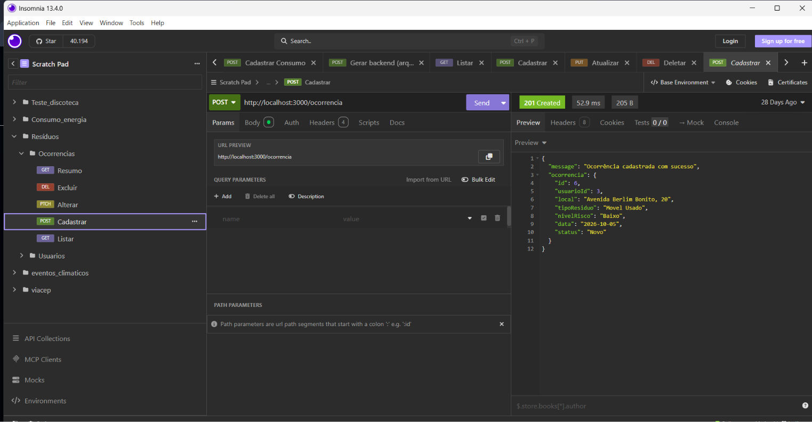

# Situação 01 - Gestão de Resíduos Sólidos

## Contextualização:
A prefeitura de Amparo precisa realizar o Monitoramento de pontos de descarte irregular, para isso desenvolver um sistema para registrar locais onde foram identificados descartes de lixo, entulho ou resíduos eletrônicos.

## Tecnologias:
- JavaScript
- Node.js
- Draw.io
- MySql

## Passo a Passo de como testar:

1. Preparar o banco: Execute o conteúdo do script.sql no seu cliente MySQL (substitua a função password() por texto plano caso ocorra erro na versão atual do MySQL).

2. Configurar a conexão: Verifique/crie o arquivo de conexão com o banco (src/config/db.js) utilizando o driver mysql2/promise.

3. Iniciar o servidor: No terminal, na pasta raiz, execute npm install para instalar as dependências e depois npm run dev para iniciar o servidor na porta 3000.

4. Testar as rotas: Utilize ferramentas como Postman, Insomnia ou Thunder Client para validar os endpoints de usuários (/usuarios/listar, /usuarios/cadastrar, etc.) e consumo (/consumo/listar, /consumo/cadastrar).

# Testes

